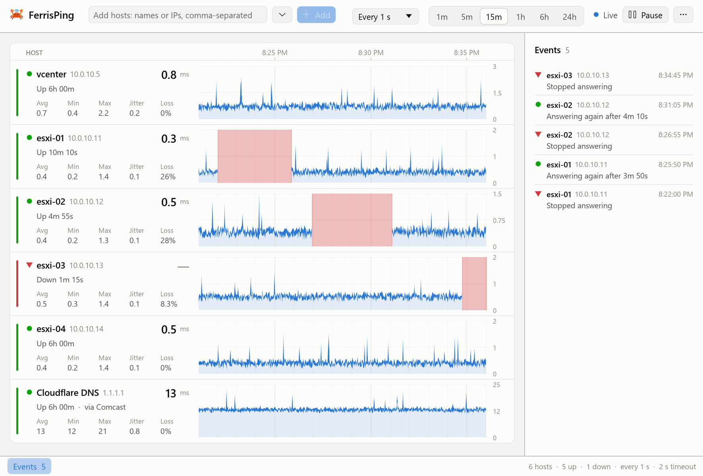
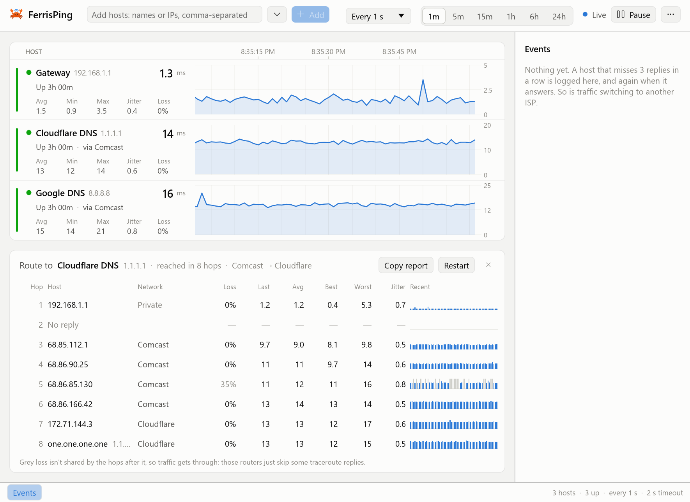

#  FerrisPing

Watch latency, packet loss, outages and route changes for several hosts at once, on Windows.

<picture>
  <source media="(prefers-color-scheme: dark)" srcset="docs/screenshots/ferrisping-dark.png">
  
</picture>

Add the hosts you care about, and FerrisPing pings each one in a lane of its own, with live graphs on one shared
time axis, so you can see which host dropped out and when. It's made for jobs like watching servers restart one
by one during a rolling update, or keeping an eye on a flaky link.

FerrisPing is new (version 0.3). It runs on Windows 10 and 11; macOS and Linux are planned.

## Features

- **A lane per host**: the current round trip, average, minimum, maximum, jitter and loss, with a graph of the last
  minute up to the last 24 hours. Drag or zoom a graph to look back, and double-click it to go back to live.
- **Names of your own**: give a host a name when you add it, or later by right-clicking its lane and choosing
  **Rename…**, which keeps its graph. Its address shows beside the name, in the lane and in the events list.
- **Outages logged**: a host that misses 3 replies in a row is marked down. The events list notes when it went
  down, when it came back and how long it was out.
- **Alerts as Windows notifications**: when a host stops answering and answers again, when its traffic switches
  to another network, and when its loss or round trips over its last pings cross limits you set, for every host
  or for one. Alerts that come together share a notification, which can play Windows' sound or not. They come
  from FerrisPing's tray icon, so there's nothing to register, and nothing goes over the network.
- **A tray icon**: its tooltip says how many hosts are down, and its menu pauses pinging or quits. With **Keep
  running in the tray when closed** on (under More options), ✕ hides the window and FerrisPing keeps pinging;
  click the icon to bring the window back.
- **Continuous traceroute**: every hop on the way to a host, measured again and again (like mtr or pathping), so
  loss and delay can be pinned on one hop.
- **The network your traffic leaves through**: each lane names the first public network on its route
  ("via Comcast"), checks it every 30 seconds, and logs a change. That's handy at a site with two ISPs. You can
  rename networks to what you call them.
- **Routes over time**: Shift+drag across a graph to see the routes the host's traffic took in that stretch of
  time, and where they differ. A dotted line on the graph marks each change of route.
- **Quick to fill**: add names or addresses separated by commas, ranges like `10.0.0.1-20` or `10.0.0.1-10.0.0.20`,
  a subnet up to a /24 like `10.0.0.0/24` (without its network and broadcast addresses), IPv6 addresses, and a
  label after an address (`10.0.0.5 Office edge`). A list pasted with a host on each line adds every host. The ⌄
  beside the box opens a bigger box, and the hosts you added or removed before, to add again with a click. In a
  narrow window the toolbar keeps just an **Add** button, which opens the same panel.
- **No admin rights, no installer**: one .exe that pings with the same Windows ICMP API as `ping.exe` and
  `tracert.exe`.
- **Jitter strips**: turn on **Show jitter under graphs**, in More options (⋯), for a strip under each graph with
  jitter: how much the round trip changes from one reply to the next, on a scale of its own. With many hosts, lanes
  are too short for it, and hovering a graph shows jitter instead.
- Light and dark themes, or follow Windows.

## Install

Download `ferrisping.exe` from [Releases](../../releases) and run it. It keeps your hosts, the hosts you added
before, interval, time window, theme, network names and alerts in `%APPDATA%\FerrisPing`. Graphs, routes and events
are kept in memory only, so they start fresh each time. To uninstall FerrisPing, delete `ferrisping.exe` and that
folder.

Like any program with a tray icon, FerrisPing then shows up in Windows' own lists of tray icons (Settings ›
Personalization › Taskbar) and of programs that send notifications (Settings › System › Notifications, where you
can turn its notifications off). Windows keeps those lists itself; FerrisPing doesn't write to the registry.

The exe isn't code-signed yet, so Windows SmartScreen may warn about it the first time: choose **More info**, then
**Run anyway**.

## Code signing policy

FerrisPing is applying to [SignPath Foundation](https://signpath.org) for free code signing. Once it's accepted, each
release will be built from this repository by GitHub Actions and approved for signing by hand.

- Committers and reviewers: [Chad Skinner](https://github.com/sknnr-chad)
- Approvers: [Chad Skinner](https://github.com/sknnr-chad)

Privacy policy: [What FerrisPing sends over the network](#what-ferrisping-sends-over-the-network)

## Tracing a route

<picture>
  <source media="(prefers-color-scheme: dark)" srcset="docs/screenshots/ferrisping-route.png">
  
</picture>

Hover a lane and click **Route**, or right-click it and choose **Trace route**. Each row is one hop: who answered,
whose network it's on, the loss, and the last, average, best and worst round trips, with the latest results on the
right. **Copy report** copies the table as text, for a ticket or a chat. Right-click a hop to watch it in a lane of
its own.

To look back instead, Shift+drag across a host's graph. The routes its traffic took in that stretch of time show
side by side, from the route checks FerrisPing makes every 30 seconds and keeps for a day. Each says when it was in
use, how many checks saw it and how many of them the host answered. Hops that differ from the route before are
highlighted, and a note says from which hop round trips got longer.

## Reading the numbers

- **Loss at a hop in the middle of a route isn't always real.** Routers often limit how many traceroute replies
  they send. When the hops after one don't share its loss, traffic is getting through, so FerrisPing greys that
  loss out and says so.
- **"via Comcast" is the first public network on the route.** Usually that's the ISP your traffic goes out
  through, but a VPN, routers that don't answer, or a site with its own network number can make it something else.
  Treat a logged switch as a strong hint, not proof.
- **Routers that take turns at a hop aren't a change of route.** Load balancing spreads traffic over several
  routers, so a new router only counts as a change once it keeps answering where none of the route's own do. "+1"
  beside a router means another one took turns with it.
- **Round trips under a millisecond are estimates.** Windows reports whole milliseconds, so FerrisPing times each
  probe itself and takes off the measured timer overhead.

## What FerrisPing sends over the network

- Pings (ICMP echo requests) to each host you add, at the interval you pick: every second unless you change it.
- For each host, a short traceroute every 30 seconds, up to 12 hops, to find the first public network on its way
  and keep a day of its routes. A host that's down gets one every 2 minutes instead, and only if it answered
  before.
- While a route is open, a traceroute to that host every second.
- DNS lookups through your usual DNS server:
  - the names of the hosts you add;
  - reverse lookups for the names of routers on a route;
  - for each public router address it sees, who owns it and what that network is called, from Team Cymru's
    IP-to-ASN mapping service. Those router addresses reach your DNS server and Team Cymru (see Team Cymru's
    [privacy policy](https://www.team-cymru.com/privacy)). Private addresses are never looked up.

Nothing else: no telemetry, no update checks, no accounts. Pausing stops the pings and traceroutes.

**Check routes and look up networks**, under More options (⋯) at the top right, turns off those short traceroutes
and the Team Cymru lookups. Lanes then don't name the network their traffic leaves through, switches aren't logged,
routes aren't kept, and an open route says "Lookups off" instead of naming its routers' networks. Router names are still
looked up. The setting is on unless you turn it off.

The first time FerrisPing starts, it shows a summary of this list with the same choice, and doesn't check routes or
look up networks until you've answered with OK. A one-off session started from the command line doesn't show the
summary: until it has been answered, a session leaves the setting off unless you turn it on there.

## Command line

```
ferrisping [hosts...] [--interval 0.5] [--window 15m] [--theme dark|light|system] [--route <host>]
```

Hosts given on the command line start a one-off session that isn't saved. `--route <host>` also opens that host's
route. A session runs on its own, while starting FerrisPing again without hosts opens the copy that's already
running, even from the tray.

## Building from source

You need Windows 10 or 11, [Rust](https://rustup.rs) 1.99 or newer, and the Visual Studio Build Tools with the
"Desktop development with C++" workload.

```
cargo build --release
```

The exe lands in `target\release\ferrisping.exe`. It's built with the C runtime linked in
(`.cargo/config.toml`), so it runs on PCs without the Visual C++ Redistributable. The first build takes several
minutes.

Before sending a change, run:

```
cargo fmt --check
cargo clippy --all-targets -- -D warnings
cargo test
```

The UI tests drive the real window without showing it, and only ping loopback addresses. The screenshots in
`docs/screenshots` are drawn from made-up hosts and routes. To redraw them, from the repository's root in
PowerShell:

```
$env:FERRISPING_RENDER_DIR = "$PWD\docs\screenshots"; cargo test -p ferrisping -- --ignored render_screenshots
```

If you add or update a dependency, regenerate `THIRD-PARTY-NOTICES.md` with
[cargo-about](https://github.com/EmbarkStudios/cargo-about) (it fetches a few license files from GitHub):

```
cargo install cargo-about --locked --features cli
cargo about generate about.hbs -o THIRD-PARTY-NOTICES.md
```

## Roadmap

Windows comes first, and macOS and Linux are next. The pinging and DNS code is the Windows-only part, so on other
systems FerrisPing doesn't work yet. After that: email alerts, saved host groups and TCP port checks. There are
no dates.

## Contributing

Issues and pull requests are welcome. FerrisPing is a small project looked after in spare time, so answers may take
a while. Please run the checks above before sending a pull request; GitHub runs them on it too.

## About

FerrisPing is made by Chad Skinner, with much of the code written by Claude, an AI model.

It started as a modern replacement for MultiPing. It's an independent project: it contains no MultiPing code, and
it isn't affiliated with Pingman Tools, who make MultiPing.

The crab is drawn in the style of Ferris, the unofficial Rust mascot, which is in the public domain.

## License

MIT; see [LICENSE](LICENSE). The libraries built into the exe have licenses of their own, collected in
[THIRD-PARTY-NOTICES.md](THIRD-PARTY-NOTICES.md).
